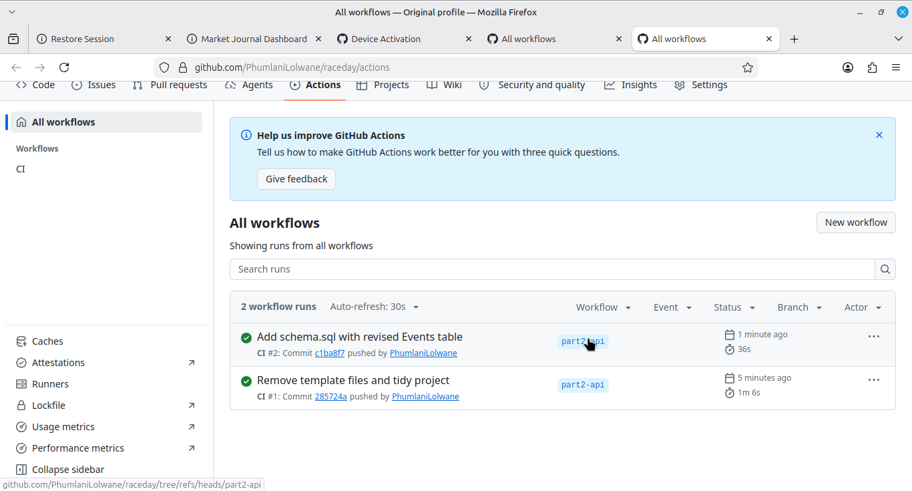

# RaceDay – Part 2: RESTful API

**This is Part 2 of the POE (RESTful API).** Work for this part lives on the branch `part2-api`.

[](https://github.com/PhumlaniLolwane/raceday/actions/workflows/ci.yml)

## About the system
RaceDay is a web platform for South African running, walking and cycling event organisers. This repository contains the
**ASP.NET Core Web API** (.NET 8, Entity Framework Core Code-First, SQL Server) that powers it. Organisers create events and
categories and capture results; participants browse events, enrol in a category and track their own results.

## The two roles
| Role | Can do |
|---|---|
| **Organiser** | Create, update and delete **their own** events; add/update/delete categories for their events; view all enrolments for their events; capture and correct finish times and positions. |
| **Participant** | Register and log in; view/update own profile; browse events and categories; enrol in (and cancel) a category; view **own** enrolments and results. |

Public (no login): list/view events, list categories, view an event's results leaderboard, register, log in.
Organiser functionality is refused (403) for Participants and vice versa; protected endpoints return 401 without a session.

## Authentication
Session-based: `POST /api/auth/login` verifies the password and starts a server-issued session (an HttpOnly cookie
`RaceDay.Session`) that carries the user's id and role on every later request. `POST /api/auth/logout` ends it.
Passwords are hashed with PBKDF2 (SHA-256, random salt, 100 000 iterations) and never stored or returned in plain text.

## Setup and run (Windows, Linux or macOS)
Prerequisites: [.NET 8 SDK](https://dotnet.microsoft.com/download), SQL Server (or Docker), and `dotnet-ef`
(`dotnet tool install --global dotnet-ef --version 8.*`).

1. **SQL Server in Docker** (skip if you have SQL Server / LocalDB):
   ```bash
   docker run -e 'ACCEPT_EULA=Y' -e 'MSSQL_SA_PASSWORD=YourStrong!Passw0rd' -p 1433:1433 --name raceday-sql -d mcr.microsoft.com/mssql/server:2022-latest
   ```
2. **Connection string**: edit `RaceDay.Api/appsettings.json` (`ConnectionStrings:DefaultConnection`) to match your server.
   (To avoid committing real passwords use `dotnet user-secrets` or the `ConnectionStrings__DefaultConnection` environment variable.)
3. **Create the database** from the EF Core migrations:
   ```bash
   cd RaceDay.Api
   dotnet ef database update
   ```
4. **Run the API**:
   ```bash
   dotnet run
   ```
   Open the printed URL (e.g. `https://localhost:7xxx/swagger`).

### Using Swagger
1. Expand `POST /api/auth/register`, **Try it out**, create an Organiser (and a Participant).
2. Call `POST /api/auth/login`. The browser stores the session cookie, so every other endpoint now works as that user.
3. To switch user, call `POST /api/auth/logout` then log in as the other account.

## Endpoints
| Method | Route | Role |
|---|---|---|
| POST | `/api/auth/register` | public |
| POST | `/api/auth/login` | public |
| POST | `/api/auth/logout` | any logged-in |
| GET / PUT | `/api/users/me` | any logged-in |
| GET | `/api/events` (filters: `location`, `eventType`, `fromDate`, `toDate`, `includePast`) | public |
| GET | `/api/events/{id}` | public |
| POST | `/api/events` | Organiser |
| PUT / DELETE | `/api/events/{id}` | Organiser (owner) |
| GET | `/api/events/{eventId}/categories` | public |
| POST | `/api/events/{eventId}/categories` | Organiser (owner) |
| PUT / DELETE | `/api/categories/{id}` | Organiser (owner) |
| POST | `/api/enrolments` | Participant |
| GET | `/api/users/me/enrolments` | Participant |
| GET | `/api/events/{eventId}/enrolments` | Organiser (owner) |
| DELETE | `/api/enrolments/{id}` | Participant (own) |
| POST | `/api/enrolments/{enrolmentId}/results` | Organiser (owner) |
| PUT | `/api/results/{id}` | Organiser (owner) |
| GET | `/api/users/me/results` | Participant |
| GET | `/api/events/{eventId}/results` | public |

## Tests
```bash
dotnet test
```
Integration tests boot the real API in memory (SQL Server swapped for an in-memory database) and cover registration, login,
password hashing, event management, wrong-role rejection, enrolments, results and categories, for both authenticated and
unauthenticated requests, including success and failure cases.

## CI/CD
`.github/workflows/ci.yml` builds the solution and runs every test on every push.

**Green build:**



## Changes from the Part 1 plan
Reflected back here as the Part 1 document requires:
- Login now uses a **session cookie** instead of a JWT, and returns the user profile (`userID`, `fullName`, `email`, `role`) instead of a token.
- Events now carry `distanceKM` and `eventType` (Run / Walk / Cycle) in create/update bodies (`Events` table gained `DistanceKM` and `EventType` columns).
- Added `POST /api/auth/logout`.
- Cancelling an enrolment sets its status to `Cancelled` (the record is kept).

## Walkthrough video
YouTube (unlisted): _add link here_
